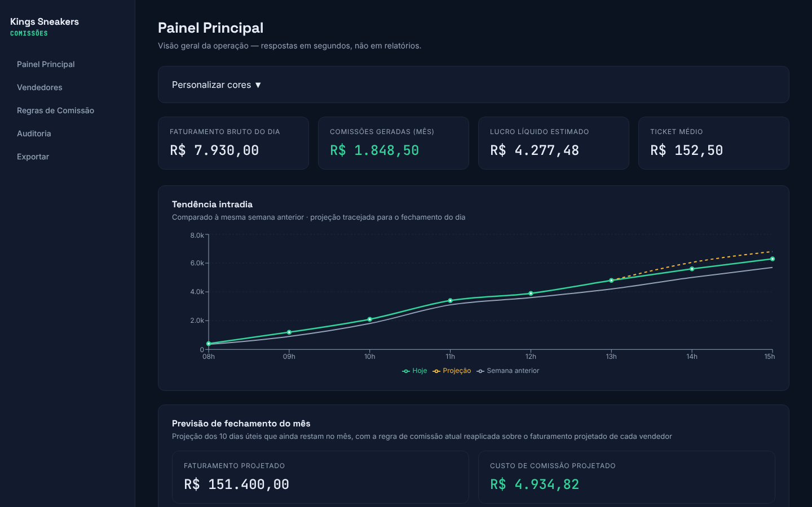
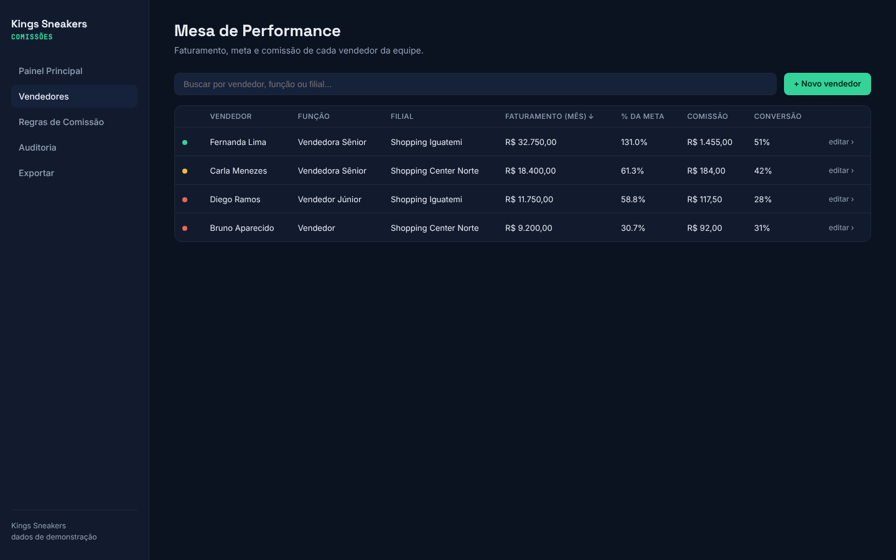
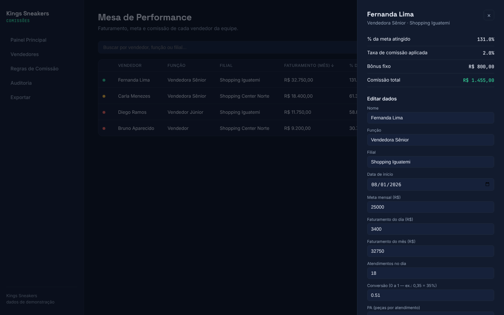
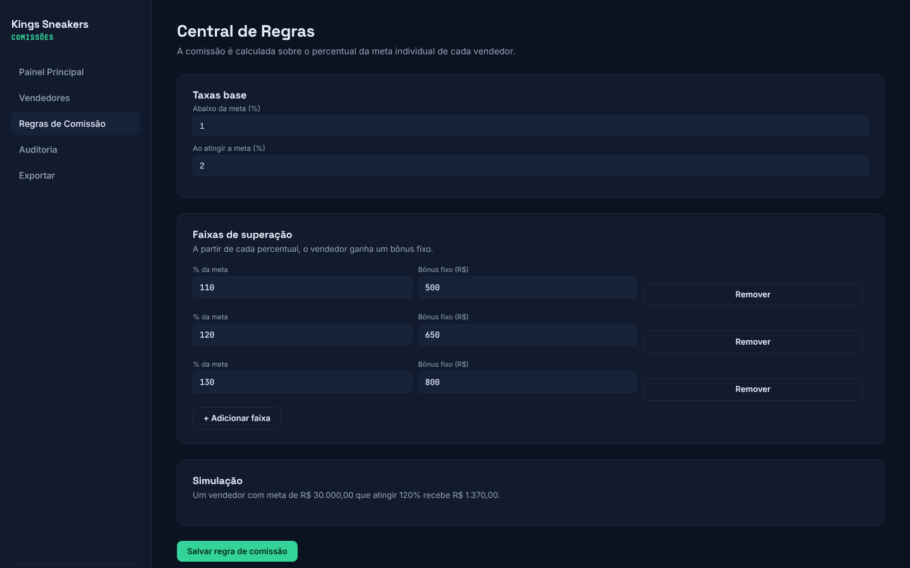
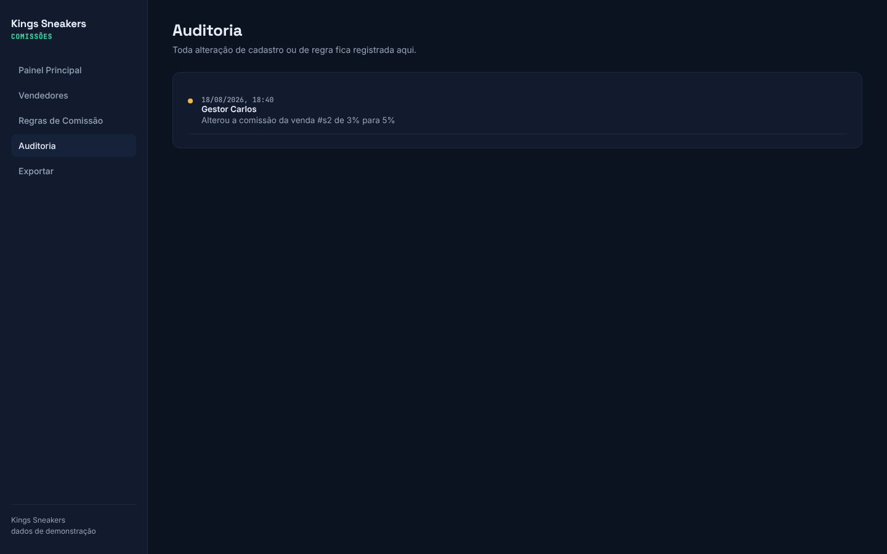
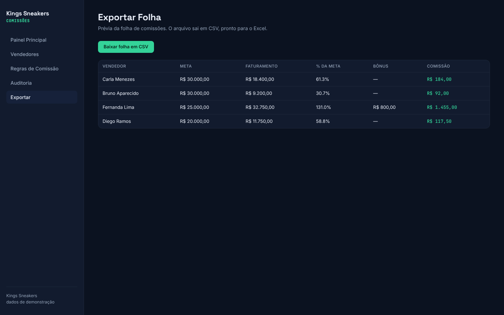

# Painel de Comissões

Painel web para o gerente de uma loja de varejo acompanhar o desempenho da equipe de vendas e calcular a comissão de cada vendedor.

**Deploy:** ainda não publicado. Roda só localmente (veja [Como rodar](#como-rodar)).

## O problema

Em loja pequena, o controle de comissão costuma viver numa planilha. Isso traz três dores:

**Erro de cálculo.** A comissão é escalonada por faixa e precisa ser aplicada sobre a meta de cada vendedor, não sobre o resultado da loja. Fazer isso à mão, todo mês, para uma equipe inteira, erra.

**Falta de visão no dia.** O gerente só descobre que a equipe está abaixo do ritmo no fechamento do mês, quando já não dá para reagir.

**Nenhum registro de mudança.** Quando alguém ajusta uma taxa, não fica registrado quem mudou nem quando.

O painel resolve os três: calcula a comissão automaticamente, mostra o desempenho do dia com projeção de fechamento, e registra toda alteração.

## Stack

| Camada    | Tecnologia                                 |
| --------- | ------------------------------------------ |
| Frontend  | React 19 + Vite 7, gráficos com Recharts 3 |
| Backend   | Node.js + Express 5 (API REST)             |
| Dados     | Em memória, no próprio servidor            |
| Estilo    | CSS puro com variáveis                     |
| Qualidade | ESLint, Prettier, Node Test Runner, Vitest |

## Como rodar

Precisa de Node.js 20.19+ ou 22.12+.

```bash
npm install
npm run dev
```

A interface abre em `http://localhost:5173` e a API sobe em `http://localhost:3001`. O Vite repassa as chamadas `/api` para a API, então não precisa configurar URL nem CORS.

Outros comandos:

```bash
npm run build   # gera o frontend em frontend/dist
npm run lint    # ESLint em backend e frontend
npm start --workspace backend   # só a API, sem o modo watch
```

Os dados ficam na memória do servidor: **reiniciar volta tudo ao estado inicial.** É proposital — o projeto roda sem instalar banco nenhum.

## Funcionalidades

**Painel principal** — faturamento do dia, comissões do mês, lucro estimado e ticket médio, com gráfico de tendência comparando o dia de hoje com a mesma semana anterior e uma projeção de fechamento do mês. As estimativas usam números fixos no código: margem de 55% para o lucro, 10 dias úteis restantes para a projeção do mês e +8% para a linha tracejada do dia.

**Personalizar cores** — cinco paletas (incluindo uma clara) escolhidas no próprio painel. A escolha fica salva no navegador.

**Mesa de performance** — a equipe em tabela, com busca por nome, função ou filial, e ordenação por qualquer coluna.

**Cadastro e edição** — adicionar, editar e remover vendedores. A comissão é recalculada a cada alteração.

**Central de regras** — as taxas e as faixas de bônus são editáveis pela interface, sem mexer em código.

**Auditoria** — toda alteração de cadastro ou de regra vira um registro com data, usuário e o que foi feito.

**Exportação** — a folha de comissões em CSV, pronta para abrir no Excel.

## Decisões

**Comissão pelo percentual da meta individual, não pelo resultado da loja.** É a regra que o produto existe para resolver: dois vendedores que faturaram o mesmo valor recebem comissões diferentes se as metas deles forem diferentes. Quem tem meta de R$ 20.000 e vendeu R$ 22.000 bateu 110%; quem tem meta de R$ 30.000 e vendeu os mesmos R$ 22.000 ficou em 73%.

**A comparação de faixa usa o percentual exato, não o arredondado.** A tela mostra "110%" para quem atingiu 109,99%, mas o pagamento usa o valor cheio. Arredondar antes de comparar faria o sistema pagar um bônus que não foi conquistado — e é a diferença de uma linha de código.

**Dados em memória, sem banco.** Para o projeto rodar com um `npm install` e nada mais. A troca por PostgreSQL é o próximo passo natural, e a API já está separada da interface justamente para isso não virar uma reescrita.

**Express separado do React.** A API é um serviço próprio, consumido por HTTP. Custa um pouco mais de configuração que um framework full-stack, mas deixa a regra de negócio testável sem subir interface, e permite que outro cliente consuma a mesma API depois.

**CSS puro com variáveis, sem framework de UI.** As cores do painel são variáveis CSS no `:root`, então a personalização de tema é só reescrevê-las — sem recompilar nada e sem duplicar folha de estilo.

## Testes

```bash
npm test
```

Dezessete testes (12 na API com o Node Test Runner, 5 na interface com Vitest):

- **Cálculo de comissão** nas quatro situações: abaixo da meta, na meta, em 110% e em 130%, mais o caso de quem quase alcançou a faixa e não recebe o bônus e o de quem não tem meta definida.
- **Validação**: cadastro sem nome e com valor negativo é recusado.
- **API**: a listagem traz a comissão calculada, id inexistente responde 404, faixa de bônus abaixo de 100% é recusada, e a exportação devolve CSV com cabeçalho de download.
- **Interface**: a tabela mostra os vendedores e a comissão, a busca envia o termo para a API, e a ficha do vendedor mostra as vendas do dia e não quebra ao salvar.

## Screenshots

**Painel principal** — cards, tendência intradia e projeção do mês



**Mesa de performance** — busca e ordenação da equipe



**Ficha do vendedor** — comissão detalhada e edição



**Central de regras** — taxas e faixas de bônus editáveis, com simulação



**Auditoria** — registro de cada alteração



**Exportação** — prévia da folha de comissões em CSV



## Próximos passos

- **Banco de dados** — trocar a memória por PostgreSQL, para os dados sobreviverem a um reinício.
- **Autenticação** — hoje toda ação é registrada como "Gestor Carlos"; falta login e perfis.
- **Deploy** — publicar em uma URL pública.
- **Lançamento de vendas pela interface** — hoje as vendas do dia vêm dos dados de exemplo.

---

Desenvolvido por **Daniel Duarte** · [GitHub](https://github.com/duartedaniel92) · [LinkedIn](https://linkedin.com/in/duartedaniel92)
